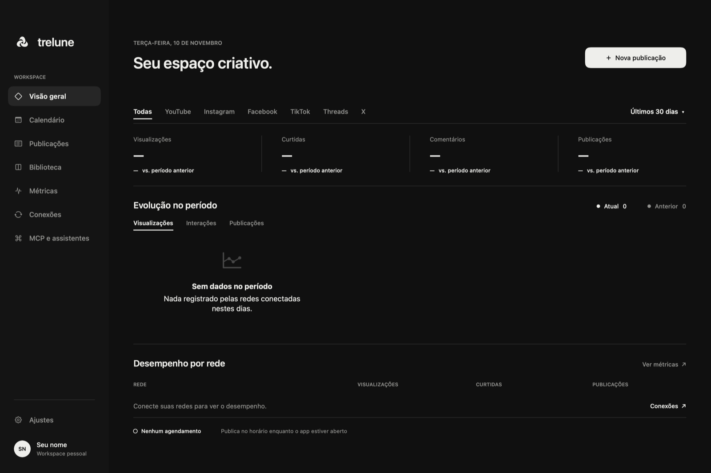
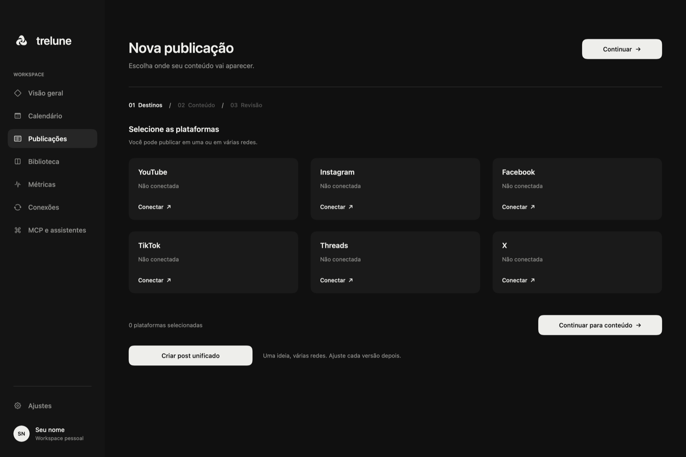
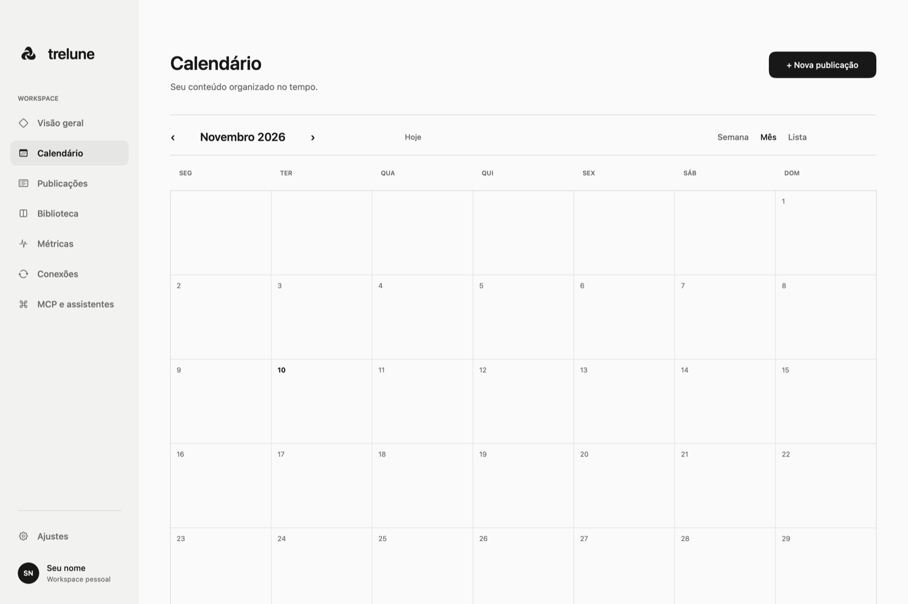

<div align="center">
  
  <h1>Trelune</h1>
  <p><strong>Seu espaço criativo, do rascunho à publicação.</strong></p>
  <p>Planeje, crie e acompanhe conteúdo para suas redes sociais em um app nativo para macOS.</p>
  <p>
    <a href="#comece-aqui">Comece aqui</a> ·
    <a href="#um-fluxo-para-suas-redes">Conheça o app</a> ·
    <a href="#redes-e-integrações">Integrações</a> ·
    <a href="#documentação">Documentação</a>
  </p>
  <p><sub>macOS 14+ &nbsp;·&nbsp; Swift 6 &nbsp;·&nbsp; Em desenvolvimento</sub></p>
</div>

<br />

<p align="center">
  
</p>

## Um fluxo para suas redes

Criar conteúdo já envolve decisões suficientes. O Trelune reúne calendário, publicações, mídia e métricas em um só lugar, com uma interface feita para o Mac. Prepare uma ideia para uma ou várias redes, ajuste os detalhes de cada destino e revise tudo antes de publicar.

<table>
  <tr>
    <td width="50%"></td>
    <td width="50%"></td>
  </tr>
  <tr>
    <td><strong>Uma ideia, vários destinos</strong><br />Escolha as redes e personalize conteúdo e opções para cada uma.</td>
    <td><strong>Seu planejamento à vista</strong><br />Organize as publicações no calendário e confira data, hora e fuso.</td>
  </tr>
</table>

### Da criação ao acompanhamento

- **Prepare:** organize imagens e vídeos, monte carrosséis, escolha a capa e reordene a mídia.
- **Revise:** confira conteúdo, privacidade, conflitos e horários antes de confirmar o envio.
- **Acompanhe:** veja resultados e falhas por canal, tente novamente quando necessário e consulte métricas e atividades recentes.
- **Trabalhe do seu jeito:** importe mídia local, exporte publicações em CSV e escolha entre aparência clara, escura ou do sistema. O app acompanha o idioma do macOS: português do Brasil ou inglês.

## Comece aqui

### Instalar

1. Baixe o `Trelune-<versão>.dmg` em [Releases](https://github.com/giovannibraaga/trelune/releases/latest). Funciona em Macs com Apple silicon e Intel, com macOS 14 Sonoma ou posterior.
2. Abra o DMG e arraste o **Trelune** para **Aplicativos**.
3. Na primeira abertura, o macOS avisa que não pode verificar o desenvolvedor, porque esta versão ainda não é notarizada pela Apple. Abra o app uma vez, clique em **OK**, vá em **Ajustes do Sistema → Privacidade e Segurança** e clique em **Abrir Mesmo Assim** ao lado de “Trelune”. Das próximas vezes ele abre normalmente. Pelo Terminal: `xattr -dr com.apple.quarantine /Applications/Trelune.app`.

O arquivo `.sha256` publicado junto permite conferir o download: `shasum -a 256 Trelune-<versão>.dmg`.

### Compilar a partir do código

**Você vai precisar de:**

- macOS 14 Sonoma ou posterior;
- Xcode 16 ou posterior, com ferramentas de linha de comando e Swift 6;
- credenciais próprias de desenvolvedor para as redes que quiser conectar. As integrações são opcionais.

```bash
git clone https://github.com/giovannibraaga/trelune.git
cd trelune
./script/build_and_run.sh
```

O script cria `dist/Trelune.app` e abre o aplicativo. Para compilar sem abri-lo, use `swift build -c release`. As opções de assinatura e identificação ficam em [`.env.example`](.env.example): copie o arquivo para `.env` se precisar configurá-las. Mantenha o mesmo `BUNDLE_ID` após conectar contas, pois ele também identifica os itens no Chaves e as preferências.

### Sua primeira publicação

1. Em **Conexões**, escolha uma rede e siga o [guia de configuração](docs/CONNECTIONS.md) para criar suas credenciais.
2. Autorize sua conta na janela oficial da plataforma.
3. Crie uma publicação, selecione os destinos e personalize o conteúdo.
4. Revise mídia, privacidade e horário. O envio acontece após sua confirmação.

## Redes e integrações

| Rede | O que você pode preparar | Antes de conectar |
|:--|:--|:--|
| **YouTube** | Vídeos, título, tags, privacidade, thumbnail e métricas | OAuth Desktop e upload retomável. |
| **Instagram** | Foto, carrossel e Reel; métricas autorizadas | Conta profissional ligada a uma Página Meta e mídia em URL HTTPS pública. |
| **Facebook Pages** | Texto, álbum de fotos e Reel; métricas autorizadas | Publicação em Páginas administradas; permissões podem exigir revisão. |
| **TikTok** | Vídeo ou carrossel de fotos; rascunho ou publicação direta | O modo de teste e a API podem restringir formatos e visibilidade. |
| **Threads** | Texto, imagem, vídeo e carrossel | Recursos sujeitos às permissões da conta e à configuração de mídia. |
| **X** | Texto e até quatro imagens ou um GIF | Vídeo não é enviado por esta integração. |

As capacidades dependem dos escopos aprovados e das APIs de cada plataforma. Consulte os detalhes em [Conexões](docs/CONNECTIONS.md) e [TikTok](docs/TIKTOK.md).

## Feito para o seu espaço

**Dados locais.** Publicações e preferências ficam em `~/Library/Application Support/Trelune/`; tokens e segredos OAuth ficam no Chaves do macOS. Você usa suas próprias credenciais para conectar as redes.

**Agendamento com opções.** Sem configuração de nuvem, o app precisa estar aberto no horário agendado. Para publicar com o Mac desligado, configure a publicação na sua própria conta AWS seguindo o [guia de nuvem](docs/CLOUD.md).

**Assistentes, se você quiser.** O servidor [MCP](mcp/) é opcional e permite que um assistente autorizado leia e gerencie publicações. O app também pode iniciar em modo MCP com `Trelune --mcp`. Configure apenas as ferramentas e permissões que deseja conceder.

O projeto não inclui serviço hospedado ou plano de assinatura oferecido pelo mantenedor. Não compartilhe nem comite tokens, segredos, arquivos de credenciais ou dados privados. Se uma credencial for exposta, revogue-a no provedor e crie outra.

## Documentação

| Guia | Para quê |
|:--|:--|
| [Conexões](docs/CONNECTIONS.md) | Configurar contas e credenciais das redes. |
| [TikTok](docs/TIKTOK.md) | Entender os detalhes da integração com o TikTok. |
| [Nuvem](docs/CLOUD.md) | Configurar hospedagem de mídia e publicação na sua AWS. |
| [MCP](mcp/) | Configurar o servidor para assistentes. |

## Desenvolvimento

```bash
swift build
swift test
```

Para gerar um instalador:

```bash
VERSION=1.0.0 ./script/release.sh
```

O script cria `dist/release/Trelune-<versão>.dmg` com o app universal (Apple silicon + Intel). Com um certificado **Developer ID Application** no Chaves, assina com hardened runtime; com `NOTARY_PROFILE` (perfil de `xcrun notarytool store-credentials`) também notariza o DMG, e o aviso da primeira abertura deixa de existir.

O código do app fica em `Sources/Trelune/`, os testes em `Tests/` e os scripts em `script/`. Issues e pull requests são bem-vindos: ao relatar um problema, inclua a versão do macOS, os passos para reproduzir e as redes envolvidas, sem credenciais ou dados privados.

## Licença

O repositório ainda não inclui um arquivo `LICENSE`. Até que uma licença seja escolhida e adicionada, não há licença open source explícita para reutilizar ou redistribuir o código.

---

<div align="center">
  Feito para dar espaço às suas ideias.<br /><br />
  <a href="https://github.com/giovannibraaga/trelune/issues">Reportar um problema</a> ·
  <a href="https://github.com/giovannibraaga/trelune/releases">Releases</a>
</div>
