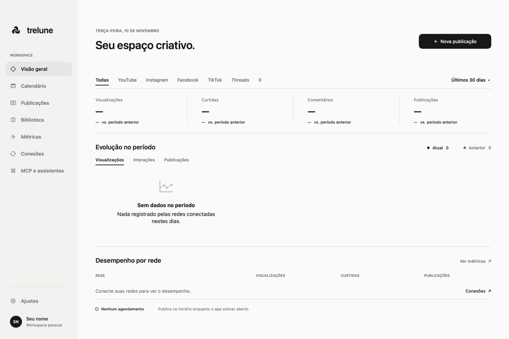

# Trelune

Organize, revise e publique conteúdo nas suas redes sociais em um app nativo para macOS. O projeto está em desenvolvimento e o código desta versão roda localmente no seu Mac.

<p align="center">
  
  
</p>

<p align="center">
  
  
</p>

Interface minimalista com modo escuro e claro (Ajustes → Aparência: Escuro, Claro ou Sistema).

## O que já dá para fazer

- Criar publicações para uma ou várias redes, com conteúdo e opções específicos por plataforma.
- Preparar carrosséis de imagens, escolher capa, reordenar arquivos e incluir vídeo.
- Rever uma publicação, escolher data, hora e fuso, conferir conflitos e confirmar o envio.
- Acompanhar publicações individuais por canal, resultados e falhas, com opção de tentar novamente.
- Consultar calendário, métricas, conteúdo em destaque e atividades recentes.
- Importar mídia de pastas locais e exportar dados de publicações para CSV.
- Conectar YouTube, Instagram, Facebook Pages, TikTok, Threads e X, respeitando os recursos e permissões de cada plataforma.
- Usar o servidor MCP opcional para que um assistente autorizado leia e gerencie publicações.

## Requisitos

- Mac com macOS 14 Sonoma ou posterior.
- Xcode 16 ou posterior, com as ferramentas de linha de comando instaladas.
- Swift 6 (incluído no Xcode).
- Credenciais próprias de desenvolvedor para as plataformas que deseja conectar. As integrações são opcionais; o passo a passo para criar cada conta está em [docs/CONNECTIONS.md](docs/CONNECTIONS.md).

## Instalação

### Baixar uma versão pronta

1. Acesse [Releases no GitHub](https://github.com/giovannibraaga/trelune/releases).
2. Baixe o arquivo da versão mais recente e mova `Trelune.app` para **Aplicativos**.
3. Abra o app. Na primeira execução, o macOS pode pedir confirmação para abrir um app baixado da internet.

O repositório ainda não tem uma release pronta publicada. Até lá, compile pelo código-fonte.

### Compilar no Mac

```bash
git clone https://github.com/giovannibraaga/trelune.git
cd trelune
./script/build_and_run.sh
```

Esse script cria `dist/Trelune.app` e abre o app. Configurações opcionais da build (bundle identifier e certificado de assinatura) ficam em um `.env` local; copie de [`.env.example`](.env.example). O `BUNDLE_ID` também separa os itens do Chaves e as preferências, então mantenha o mesmo valor depois de conectar contas.

Para compilar sem abri-lo:

```bash
swift build -c release
```

## Primeiros passos

1. Abra **Conexões** e escolha uma rede.
2. Se ainda não tiver, crie a conta de desenvolvedor e o app da rede seguindo [docs/CONNECTIONS.md](docs/CONNECTIONS.md). O próprio app tem os botões **Guia de configuração** e **Abrir portal de desenvolvedores**.
3. Autorize a conta na janela oficial da plataforma.
4. Crie uma publicação e escolha os destinos. Personalize texto, título e opções por rede, quando disponíveis.
5. Revise mídia, conteúdo, privacidade, data e hora. A publicação só é enviada depois da sua confirmação.

Os detalhes de cada integração estão em [docs/CONNECTIONS.md](docs/CONNECTIONS.md) e [docs/TIKTOK.md](docs/TIKTOK.md). Hospedagem de mídia e publicação pela nuvem, na sua própria conta AWS, estão em [docs/CLOUD.md](docs/CLOUD.md).

## Integrações

| Rede | Capacidades atuais | Notas |
|---|---|---|
| YouTube | Vídeos, título, tags, privacidade, thumbnail e métricas | O envio usa OAuth Desktop e upload retomável. |
| Instagram | Foto, carrossel e Reel; métricas autorizadas | Precisa de conta profissional ligada a uma Página Meta; mídia precisa de URL HTTPS pública. |
| Facebook Pages | Texto, álbum de fotos e Reel; métricas autorizadas | Publica em Páginas que você administra, não em perfis pessoais. Permissões podem exigir revisão. |
| TikTok | Vídeo ou carrossel de fotos; rascunho na caixa de entrada ou publicação direta, quando permitida | A API e o modo de teste podem restringir visibilidade e formatos. |
| Threads | Texto, imagem, vídeo e carrossel, conforme permissões da conta | A conexão e hospedagem temporária de mídia exigem configuração. |
| X | Texto e até quatro imagens ou um GIF | Vídeos não são enviados por esta integração. |

O suporte pode variar com os escopos aprovados e as mudanças nas APIs oficiais. Veja a situação detalhada em [documentação de conexões](docs/CONNECTIONS.md).

## Dados e credenciais

- Publicações e preferências são guardadas localmente em `~/Library/Application Support/Trelune/`.
- Tokens e segredos OAuth ficam no **Chaves do macOS**.
- O código não traz nenhuma chave, ID de app ou conta: cada pessoa usa as próprias credenciais, digitadas no app, e a própria conta AWS (opcional).
- Conexões com redes enviam dados à plataforma escolhida quando você autoriza e confirma uma ação.
- Não comite `.env`, tokens, segredos de cliente OAuth, arquivos de credenciais ou dados privados de contas.
- Se uma credencial for exposta, revogue-a no portal do provedor e crie outra; apagar o valor do arquivo não apaga o histórico Git.

## Servidor MCP opcional

O servidor MCP é um componente separado do fluxo principal do app, mantido em [`mcp/`](mcp/). O app macOS também pode iniciar seu modo MCP por `Trelune --mcp`. Os dois modos podem acessar o mesmo arquivo local de publicações; configure apenas ferramentas e permissões que você entende e quer conceder ao assistente.

Consulte [`mcp/`](mcp/) e a seção **MCP e assistentes** no app para as opções de execução e configuração. O servidor MCP não precisa ser instalado para usar o app.

## Desenvolvimento

```bash
swift build
swift test
```

O app está em `Sources/Trelune/`, os testes em `Tests/` e os scripts auxiliares em `script/`. A documentação das integrações fica em `docs/`.

## O que não está incluído nesta versão

- Um plano de assinatura ou serviço hospedado pelo mantenedor.
- Armazenamento de mídia ou agendamento oferecido em nuvem pelo mantenedor. A publicação com o Mac desligado usa a sua conta AWS ([docs/CLOUD.md](docs/CLOUD.md)); sem ela, o agendamento local depende do app estar aberto.
- Integrações com qualquer endpoint além dos documentados para cada rede.

Essas decisões podem mudar em uma oferta hospedada futura, mas não fazem parte do uso desta versão open source.

## Contribuições

Issues e pull requests são bem-vindos. Descreva a versão do macOS, os passos para reproduzir e quais redes estão envolvidas. Não inclua credenciais, dados pessoais, capturas com informações de conta, nem logs que contenham tokens.

## Licença

O repositório ainda não inclui um arquivo `LICENSE`. Até que uma licença seja escolhida e adicionada, não há uma licença open source explícita para reutilizar ou redistribuir o código.

---

[Baixar uma versão para macOS](https://github.com/giovannibraaga/trelune/releases/latest) · [Código-fonte](https://github.com/giovannibraaga/trelune) · [Reportar um problema](https://github.com/giovannibraaga/trelune/issues)
