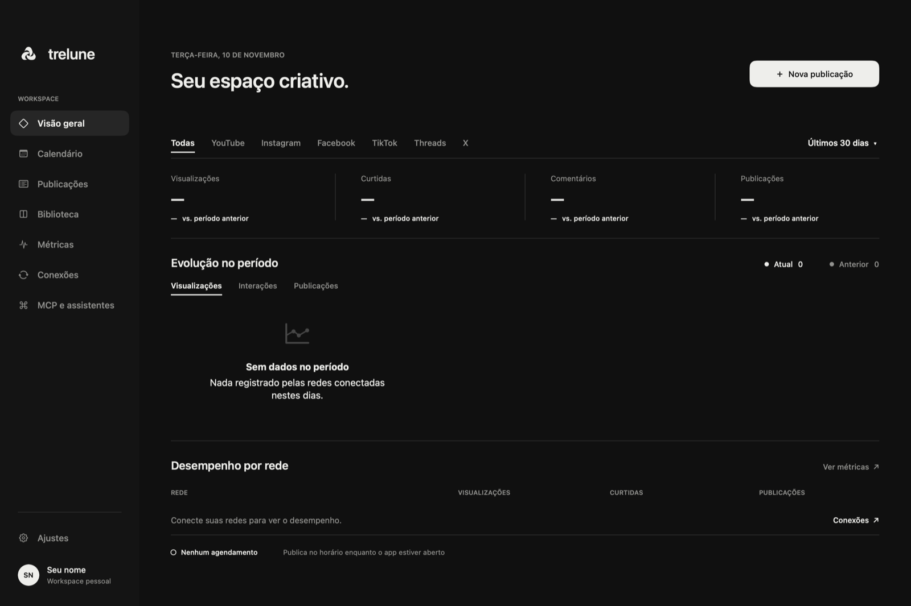

<div align="center">
  
  <h1>Trelune</h1>
  <p><strong>Seu espaço criativo, do rascunho à publicação.</strong></p>
  <p>Planeje, crie e acompanhe conteúdo para suas redes sociais em um app nativo para macOS.</p>
  <p>macOS 14+ · Apple silicon e Intel · <a href="README.md">English</a></p>
</div>

<p align="center"></p>

## O que você pode fazer

- Organizar ideias, publicações e horários em um calendário.
- Preparar texto e mídia para várias redes e personalizar cada destino.
- Revisar privacidade, conteúdo e horário antes de publicar ou agendar.
- Acompanhar resultados, falhas e métricas disponibilizadas pelas plataformas.
- Importar mídia local, exportar publicações em CSV e escolher aparência clara, escura ou do sistema.
- Conectar assistentes com MCP e, opcionalmente, usar sua própria infraestrutura AWS.

O idioma do app acompanha o macOS: português do Brasil ou inglês.

## Requisitos

- Mac com **macOS 14 Sonoma ou posterior**, com processador Apple silicon ou Intel.
- Internet para baixar o aplicativo e usar as redes conectadas.
- Credenciais próprias de desenvolvedor para cada rede que você decidir conectar. Você pode instalar e explorar o app sem configurar integrações.
- Para compilar o código: Xcode 16 ou posterior, ferramentas de linha de comando e Swift 6.

## Instalação pelo DMG

1. Acesse a [versão mais recente](https://github.com/giovannibraaga/trelune/releases/latest) e baixe `Trelune-<versão>.dmg`.
2. Abra o arquivo baixado e arraste **Trelune** para **Aplicativos**.
3. Abra o Trelune na pasta Aplicativos. A versão atual ainda não é notarizada pela Apple, então o macOS pode impedir a primeira abertura. Se isso acontecer, feche o aviso, acesse **Ajustes do Sistema → Privacidade e Segurança** e clique em **Abrir Mesmo Assim** ao lado do Trelune.
4. No app, abra **Conexões** para configurar as redes que deseja usar.

A página da versão também oferece `Trelune-<versão>.pkg`. Se preferir, abra esse instalador e siga as instruções para instalar em Aplicativos. O macOS também pode avisar sobre a assinatura desse arquivo.

### Verificar o download

Baixe o arquivo `.sha256` correspondente ao DMG ou PKG na mesma pasta do instalador. No Terminal, acesse essa pasta e execute o comando com o nome real do arquivo de verificação. Por exemplo, para a versão 1.0.0:

```bash
cd ~/Downloads
shasum -a 256 -c Trelune-1.0.0.dmg.sha256
```

O resultado deve mostrar `OK`. A verificação confirma que o arquivo corresponde ao checksum publicado na versão; ela não comprova a identidade do responsável pela publicação.

## Instalação ou atualização pelo Terminal

Se preferir, revise primeiro o conteúdo de [`install.sh`](install.sh) e execute:

```bash
curl -fsSL https://raw.githubusercontent.com/giovannibraaga/trelune/main/install.sh | bash
```

O script baixa a versão mais recente e o checksum, verifica o download, substitui uma instalação existente em `/Applications` e abre o app. Se essa pasta não puder ser gravada, usa `~/Applications`. Ele fecha uma instância aberta antes de substituir o aplicativo. Execute scripts baixados somente depois de revisar e confiar na origem.

## Sua primeira publicação

1. Em **Conexões**, escolha uma rede e siga o [guia de conexão](docs/CONNECTIONS.md) para criar e informar suas credenciais de desenvolvedor.
2. Autorize a conta conforme as instruções da rede.
3. Crie uma publicação, escolha um ou mais destinos conectados e adicione texto e mídia.
4. Ajuste as opções de cada destino e confira prévia, privacidade e mensagens de validação.
5. Confirme a publicação imediata ou escolha data, hora e fuso e confirme o agendamento. Acompanhe o resultado em **Publicações** ou no calendário.

As integrações são opcionais. Algumas redes exigem um tipo específico de conta, permissões aprovadas, revisão do aplicativo ou mídia disponível por URL HTTPS pública.

## Redes e integrações

| Rede | Recursos | Antes de conectar |
|:--|:--|:--|
| YouTube | Vídeos, título, tags, privacidade, thumbnail e métricas | Projeto Google Cloud e cliente OAuth para app de computador. |
| Instagram | Fotos, carrosséis, Reels e métricas autorizadas | Conta profissional vinculada a uma Página Meta e mídia em URL HTTPS pública. |
| Facebook Pages | Texto, álbuns e Reels; métricas autorizadas | Página administrada e permissões da Meta; algumas exigem revisão. |
| TikTok | Vídeo ou carrossel de fotos, rascunho ou publicação direta | Login Kit e Content Posting API; modo de teste e revisão podem restringir o uso. |
| Threads | Texto, imagens, vídeos e carrosséis | Permissões da conta e hospedagem HTTPS para mídia. |
| X | Texto e até quatro imagens ou um GIF | Acesso à API com permissão de escrita; a integração não envia vídeo. |

As capacidades dependem das permissões concedidas e das APIs de cada plataforma. Veja [Conexões](docs/CONNECTIONS.md) e [TikTok](docs/TIKTOK.md) para configuração e limites.

## Agendamento, dados e assistentes

**Agendamento local.** Sem publicação pela nuvem, o Trelune precisa continuar aberto no horário agendado; a janela pode estar fechada e o app permanecer na barra de menus.

**Nuvem opcional.** Para publicar com o Mac desligado, configure a publicação na sua própria conta AWS. Instagram, mídia no Threads e fotos no TikTok também precisam de mídia em URL HTTPS pública. Veja o [guia de nuvem](docs/CLOUD.md); os recursos da AWS podem gerar cobranças conforme o uso.

**Dados locais.** Publicações e configurações ficam em `~/Library/Application Support/Trelune/`; tokens e segredos OAuth ficam no Chaves do macOS. O projeto não oferece um servidor hospedado ou plano de assinatura.

**Assistentes.** Em **MCP e assistentes**, ative o acesso e escolha as permissões desejadas. O app pode funcionar como servidor com `Trelune --mcp`; há também uma opção em contêiner na pasta [mcp](mcp/). Configure apenas os acessos que deseja conceder. Publicação imediata e gerenciamento do workspace têm permissões independentes, desativadas por padrão. Validação, métricas e as ações que usam conexões exigem o app atualizado aberto. Veja a [cobertura e os requisitos do MCP](mcp/COBERTURA.md).

## Atualizar e desinstalar

Para atualizar, instale a versão mais recente sobre a instalação existente ou execute novamente o instalador pelo Terminal. Feche o Trelune antes de substituí-lo. Os dados ficam separados do aplicativo; faça backup antes de alterá-los ou removê-los.

Para desinstalar, encerre o Trelune e mova `Trelune.app` da pasta Aplicativos para o Lixo. Isso **não** apaga os dados em `~/Library/Application Support/Trelune/`, as credenciais no Chaves nem recursos opcionais na AWS. Remova esses itens separadamente apenas se não precisar mais deles.

## Compilar a partir do código

```bash
git clone https://github.com/giovannibraaga/trelune.git
cd trelune
./script/build_and_run.sh
```

O script compila `dist/Trelune.app` e o abre. Para compilar sem abrir, execute `swift build -c release`. Os ajustes em [`.env.example`](.env.example) são opcionais; copie para `.env` apenas se precisar alterá-los. Mantenha o mesmo `BUNDLE_ID` depois de conectar contas, pois ele também identifica os itens do Chaves e as preferências. Sem um certificado Apple Development, a assinatura é ad hoc e o Chaves pode pedir permissão novamente após cada compilação.

Para desenvolver e testar:

```bash
swift build
swift test
```

Para gerar um DMG e um PKG universais para Apple silicon e Intel:

```bash
VERSION=1.0.0 ./script/release.sh
```

Os arquivos ficam em `dist/release/`. O script pode assinar e notarizar a distribuição quando as credenciais necessárias estiverem configuradas; consulte os comentários em [`script/release.sh`](script/release.sh). O código do app está em `Sources/Trelune/`, os testes em `Tests/` e os scripts em `script/`.

## Problemas comuns

- **O macOS não abre o app:** siga as instruções de primeira abertura acima e confira se o download veio da página oficial do repositório.
- **Uma conexão ou publicação falha:** revise credenciais, tipo de conta, permissões e exigências de revisão no [guia de conexões](docs/CONNECTIONS.md). Para mídia que exige URL HTTPS, confira também a hospedagem.
- **Uma publicação agendada não foi enviada:** confira data e fuso. Sem nuvem, o Trelune precisa estar em execução; com nuvem, confira a configuração e as permissões da AWS.
- **O Chaves pede permissão a cada compilação:** use uma identidade de assinatura Apple Development estável e mantenha o mesmo `BUNDLE_ID`.

Para outros problemas, [abra uma issue](https://github.com/giovannibraaga/trelune/issues) com as versões do macOS e do Trelune e os passos para reproduzir. Não inclua tokens, senhas ou conteúdo privado.

## Documentação e segurança

- [Conexões](docs/CONNECTIONS.md): credenciais e configuração das redes.
- [TikTok](docs/TIKTOK.md): detalhes da integração.
- [Nuvem](docs/CLOUD.md): hospedagem de mídia e publicação na sua AWS.
- [MCP](mcp/): arquivos da integração com assistentes.
- [Política de segurança](SECURITY.md): como relatar uma vulnerabilidade em particular. Não publique detalhes sensíveis em issues.

O Trelune é distribuído sob a [licença MIT](LICENSE). Issues e pull requests são bem-vindos.
